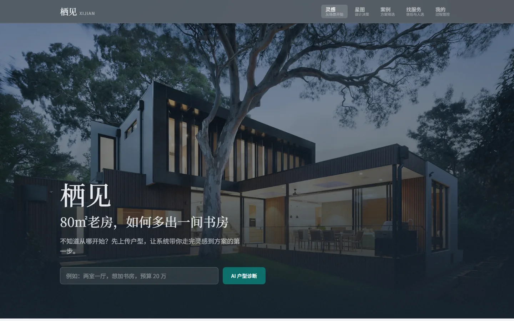
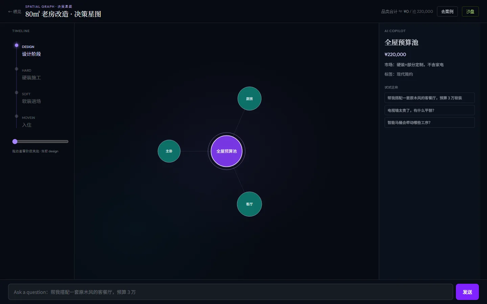
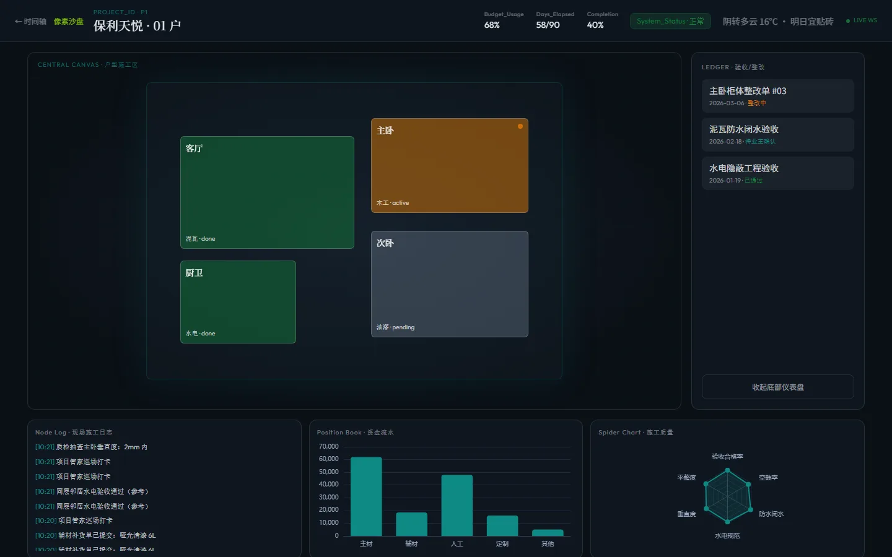
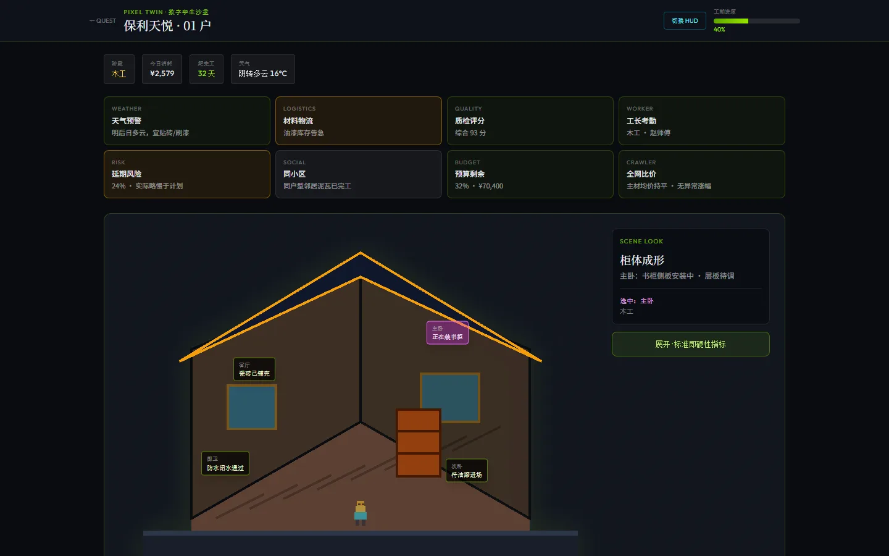

# 栖见 · Xijian

[](https://github.com/lgl2wmt-png/xijian/actions/workflows/ci.yml)
[](./LICENSE)
[](https://github.com/lgl2wmt-png/xijian/releases)
[](https://nodejs.org/)

按**用户旅程**组织的开源家装平台：灵感 → 方案 → 信任 → 转化 → 过程管控。

> 每个页面只解决一个焦虑——从哪开始、能不能实现、选谁、做得怎么样。

## 功能一览

| 路由 | 能力 |
|------|------|
| `/` | 场景英雄区、AI 户型诊断入口、风格导航 |
| `/galaxy` | 决策星图：预算引力场、约束/冲突连线、AI 平替 |
| `/cases` | 结构化案例（面积 / 造价 / 工期） |
| `/designers` | 按户型·风格·预算筛选 + 极简预约 |
| `/progress` | 工序时间轴 + 验收/整改入库 |
| `/hud` | 智慧工地 HUD（实时日志 WebSocket） |
| `/sandbox` | 像素数字孪生沙盘 + 通关勋章 |

## 截图

| 首页 | 决策星图 |
|:---:|:---:|
|  |  |

| 智慧工地 HUD | 像素沙盘 |
|:---:|:---:|
|  |  |

更多：`cases` / `designers` / `progress` 同目录。重新生成：

```bash
npm run dev          # 另开终端
npm run screenshots  # Playwright → docs/screenshots/
```

## 快速开始

**要求：** Node.js 22+

```bash
npm install
npm run dev
```

| 服务 | 地址 |
|------|------|
| 前端（Vite） | http://localhost:5173 |
| API + WS | http://localhost:8787 |
| 决策星图 | http://localhost:5173/galaxy |
| 智慧工地 | http://localhost:5173/hud |
| 像素沙盘 | http://localhost:5173/sandbox |

```bash
npm run build      # 生产构建（PWA：dist/ + sw.js）
npm run lint       # 静态检查
docker compose up --build   # 单端口一体体验 → :8787
npx vercel --prod  # 静态 PWA 上 Vercel（需登录；见 docs/DEPLOY.md）
```

更完整的部署说明见 [docs/DEPLOY.md](./docs/DEPLOY.md)。iPhone：Safari → 添加到主屏幕。

## 架构

```
浏览器 ──► Vite (:5173) ──proxy──► Express (:8787)
                                      │
                                      ├─ SQLite (server/data/)
                                      └─ WebSocket /ws?project=p1
```

生产 Docker 镜像会把 `dist` 静态资源交由 Express 同端口托管。

## 技术栈

- **前端：** Vite · React 19 · TypeScript · Tailwind CSS 4 · ECharts · React Router
- **后端：** Express 5 · better-sqlite3 · ws
- **工程：** GitHub Actions CI · Docker Compose · Capacitor · PWA（Vercel）
- **许可：** [MIT](./LICENSE)

## 开源协作

| 文件 | 用途 |
|------|------|
| [CONTRIBUTING.md](./CONTRIBUTING.md) | 如何提 Issue / PR |
| [CODE_OF_CONDUCT.md](./CODE_OF_CONDUCT.md) | 行为准则 |
| [SECURITY.md](./SECURITY.md) | 漏洞报告 |
| [CHANGELOG.md](./CHANGELOG.md) | 版本历史 |
| [RELEASE_NOTES.md](./RELEASE_NOTES.md) | 当前里程碑说明 |

欢迎提 Issue / Discussion。路线图见仓库中的 **v0.5.0 开发计划** Issue。

## 安全提示

- 仓库仅包含 `.env.example`，**不要**提交真实 `.env` / Token / SQLite 数据库
- 发布前对照 [SECURITY.md](./SECURITY.md) 自查清单
